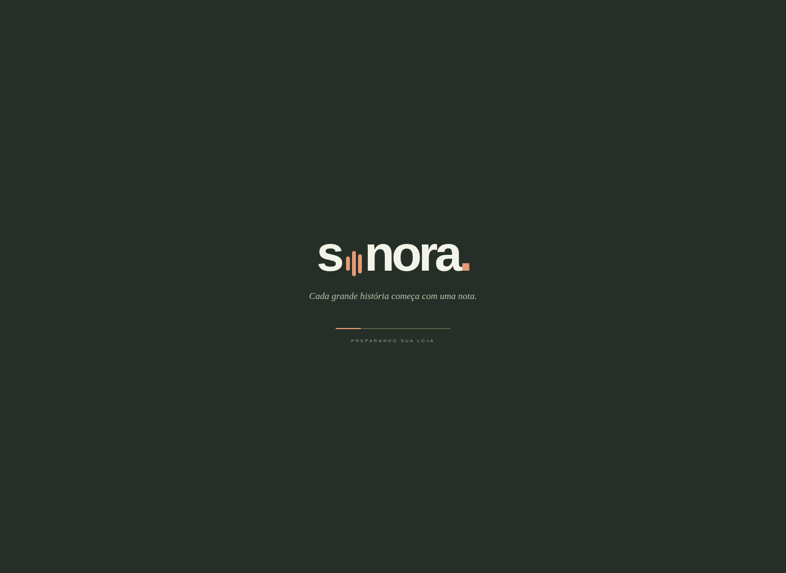
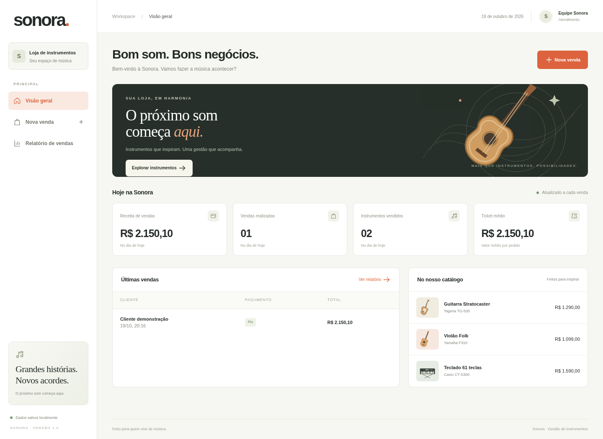
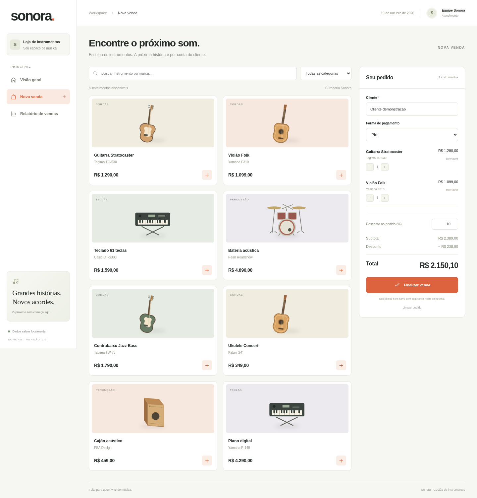
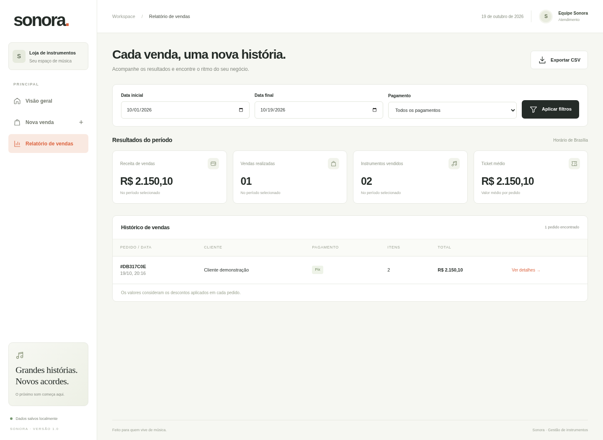

# Sonora — galeria para avaliação

Estas são capturas reais da **interface web de apoio**, usando uma venda fictícia de demonstração. O aplicativo Windows Forms tem janelas próprias; seu visual nativo ainda não foi capturado nem validado no Windows. Esta galeria permite avaliar a interface de apoio, sem apresentá-la como captura do aplicativo desktop.

## Abertura

## Menu principal

## Venda de instrumentos

Carrinho com guitarra e violão, pagamento Pix e desconto de 10%. Total esperado: R$ 2.150,10.

## Relatório de vendas

Filtros de período e pagamento, indicadores, detalhes do pedido e exportação CSV.

